# Kết quả load testing

## Phạm vi và cách đọc

Báo cáo này tổng hợp từ các ảnh kết quả k6 trong thư mục `../../Images/`. Ảnh không hiển thị ngày chạy hoặc cấu hình máy, nên chưa thể so sánh giữa các môi trường khác nhau.

Các bài test trong ảnh ramp lên mức VU ghi trong bảng trong 15 giây; thời lượng tối đa hiển thị là 45 giây, bao gồm thời gian graceful stop. Ngưỡng đánh giá theo cấu hình k6 hiện tại:

- Tỷ lệ request lỗi: `< 5%`.
- p95 thời gian phản hồi: `< 800 ms`.

## Tóm tắt

| Service | VU tối đa | Request | p95 | Request lỗi | Check thành công | Kết quả |
|---|---:|---:|---:|---:|---:|---|
| Cart | 5 | 79 | 13.75 ms | 0% | 158/158 | Đạt |
| Cart | 20 | 313 | 11.31 ms | 0% | 626/626 | Đạt |
| Cart | 100 | 1,571 | 13.95 ms | 0% | 3,142/3,142 | Đạt |
| Order | 50 | 1,129 | 35.44 ms | 0% | 2,258/2,258 | Đạt |
| Order | 100 | 2,230 | 59.12 ms | 0% | 4,460/4,460 | Đạt |
| Order | 200 | 2,900 | 1.51 s | 2.31% | 5,666/5,800 | Không đạt p95; tỷ lệ lỗi vẫn dưới ngưỡng |
| Product | 1 | 110 | 98.93 ms | 0% | 220/220 | Đạt |
| Product | 5 | 209 | 112.23 ms | 0% | 418/418 | Đạt |
| Product | 10 | 215 | 196.52 ms | 0% | 430/430 | Đạt p95; có request chậm bất thường |
| Product | 20 | 139 | 11.27 s | 0% | 278/278 | Không đạt p95 |
| Product | 50 | 150 | 18.26 s | 0% | 300/300 | Không đạt p95 |

## Phân tích

### Cart service

Ở cả ba mức 5, 20 và 100 VU, p95 nằm trong khoảng 11.31–13.95 ms, không có request lỗi và tất cả check đều thành công. Trong phạm vi các lần chạy ngắn này, cart service giữ được latency ổn định đến 100 VU.

### Order service

Ở 50 và 100 VU, p95 lần lượt là 35.44 ms và 59.12 ms, không có lỗi. Ở 200 VU, p95 tăng lên 1.51 giây, vượt ngưỡng 800 ms. Tỷ lệ request lỗi là 2.31%, thấp hơn ngưỡng 5%, nhưng một số check status thất bại; ảnh cho thấy 67/2,900 request lỗi và 134/5,800 check không thành công.

Vì vậy, 100 VU là mức cao nhất trong ảnh còn đạt cả hai ngưỡng. Ở 200 VU, cần điều tra latency và lỗi 5xx khi tải cao.

### Product service

Ở 1, 5 và 10 VU, p95 lần lượt là 98.93 ms, 112.23 ms và 196.52 ms; không có request lỗi. Tuy nhiên, lần chạy 10 VU có response tối đa 17.07 giây dù p95 đạt ngưỡng, cho thấy có outlier đáng kể.

Từ 20 VU trở lên, p95 tăng mạnh lên 11.27–18.26 giây nên hai lần chạy không đạt ngưỡng latency. Tỷ lệ lỗi HTTP vẫn là 0%, nghĩa là vấn đề thể hiện chủ yếu ở thời gian phản hồi, không phải request bị từ chối.

## Kết luận và đề xuất

- **Cart:** kết quả tốt trong các mức tải đã chụp; có thể tiếp tục kiểm tra với thời lượng ổn định dài hơn để xác nhận.
- **Order:** 50–100 VU đạt ngưỡng; 200 VU bắt đầu suy giảm rõ rệt. Nên kiểm tra truy vấn cơ sở dữ liệu, connection pool và log lỗi tại mức tải này.
- **Product:** kết quả suy giảm mạnh giữa 10 và 20 VU. Nên kiểm tra các truy vấn/filter sản phẩm, tài nguyên DB và connection pool; chạy lại theo từng nấc tải để xác định điểm bắt đầu suy giảm.
- Các ảnh ở 20–50 VU của product và 200 VU của order có iteration bị ngắt khi k6 kết thúc ramp-down. Đây không đồng nghĩa toàn bộ các iteration đó là HTTP lỗi, nhưng cần lưu ý khi so sánh tổng số iteration.
- Các kết quả này là ảnh chụp các lần chạy ngắn, chưa đủ để kết luận giới hạn tải sản xuất. Nên ghi thêm ngày chạy, commit/build, cấu hình máy và thời lượng ổn định khi chạy lại.

## Ảnh kết quả

### Cart service

#### 5 VU

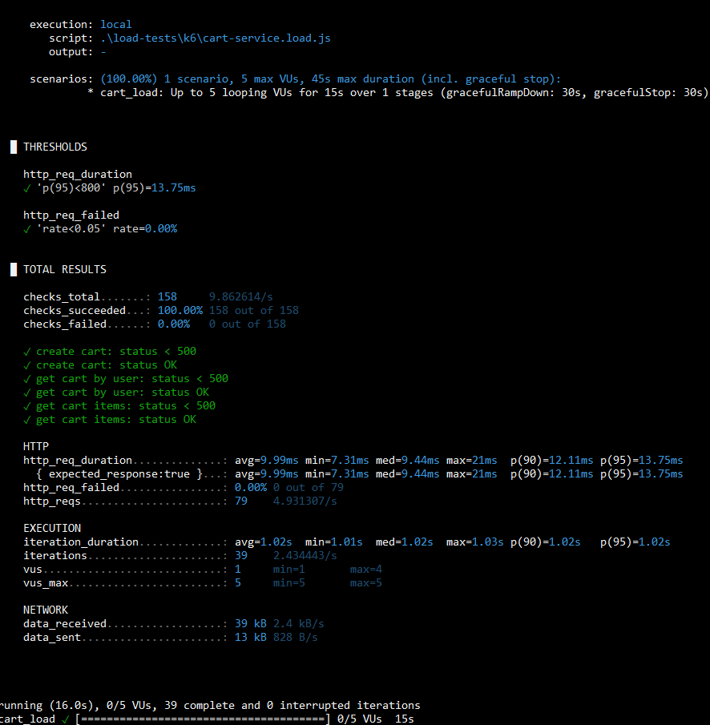

#### 20 VU

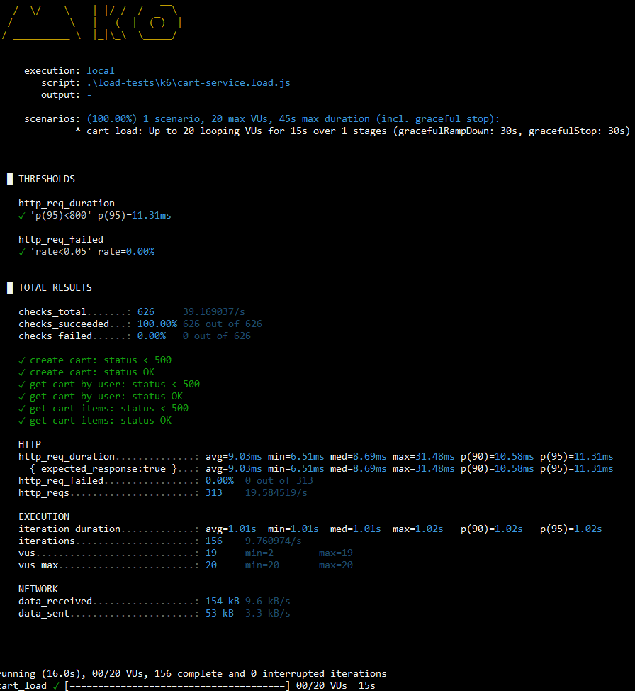

#### 100 VU

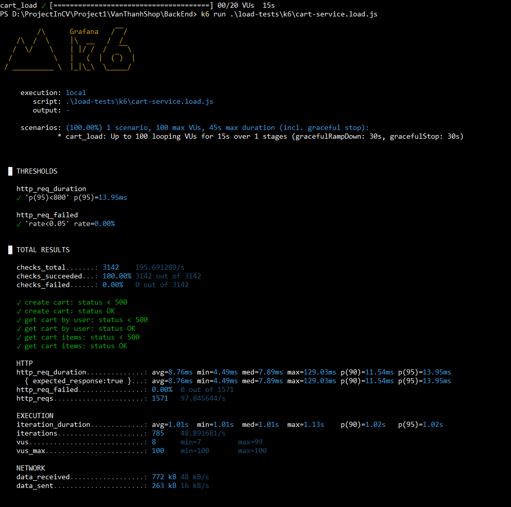

### Order service

#### 50 VU

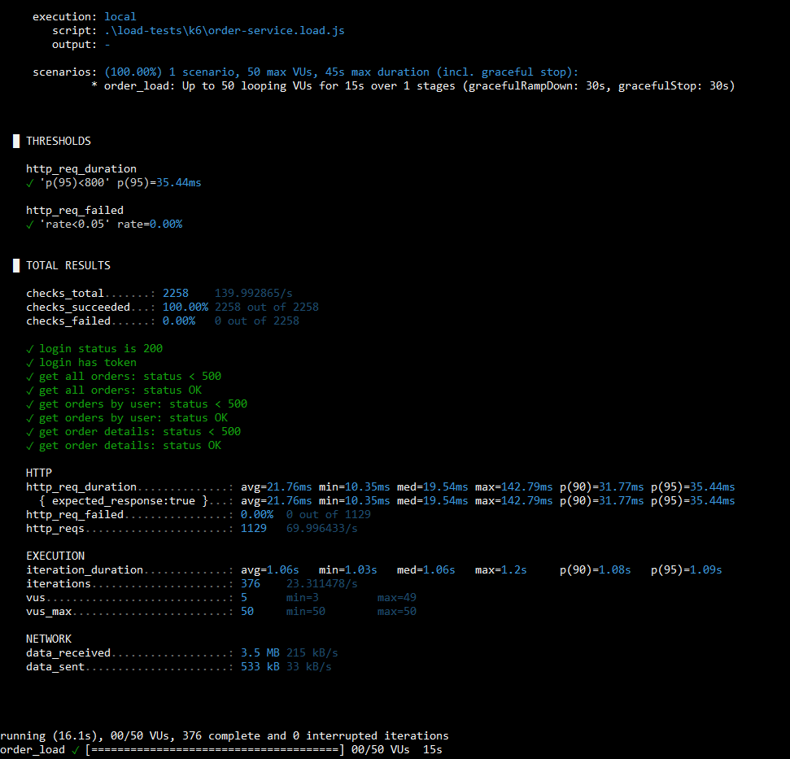

#### 100 VU

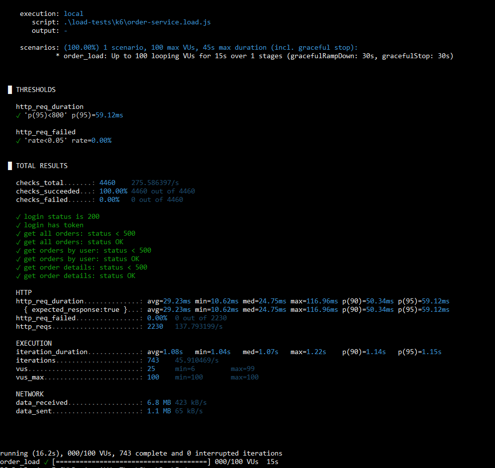

#### 200 VU

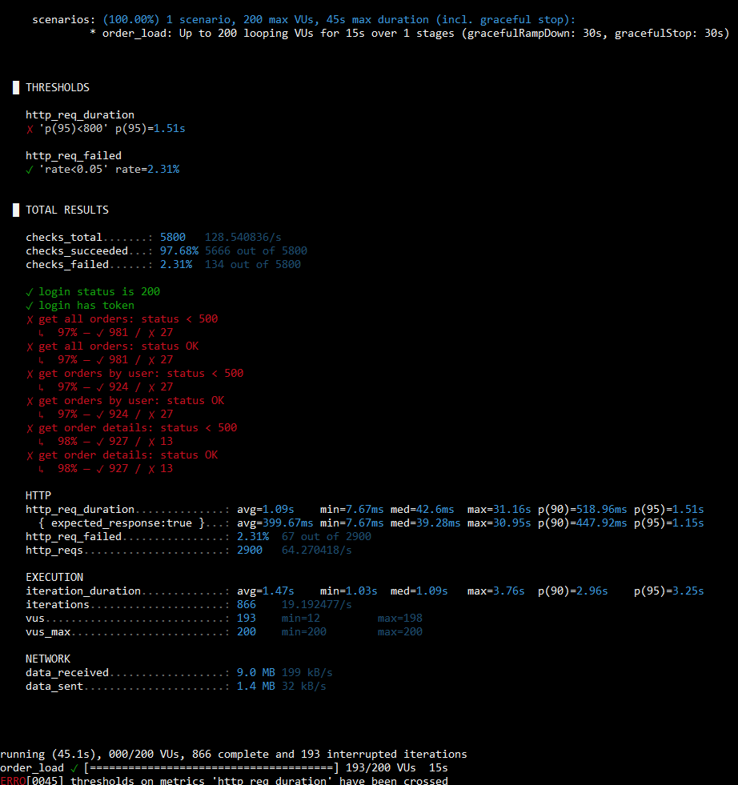

### Product service

#### 1 VU

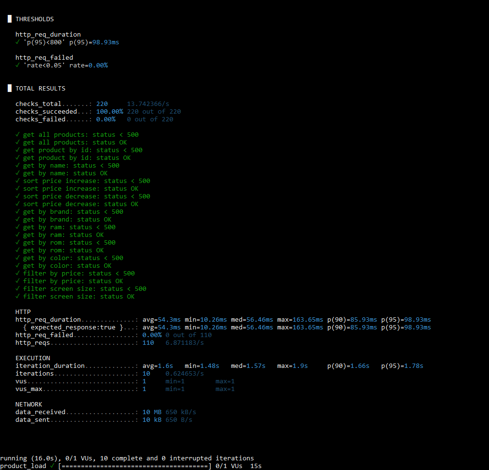

#### 5 VU

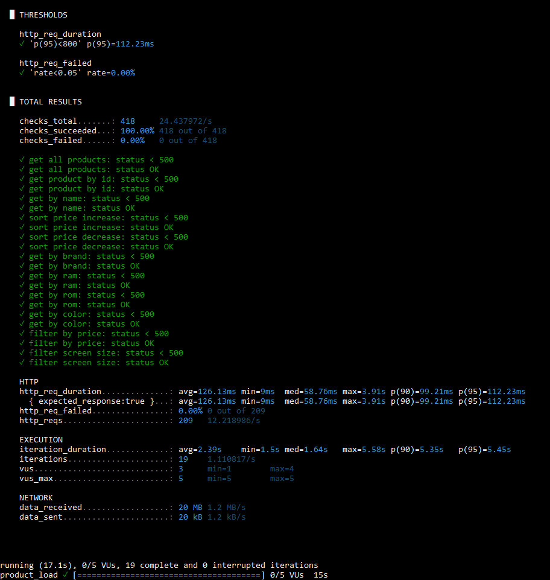

#### 10 VU

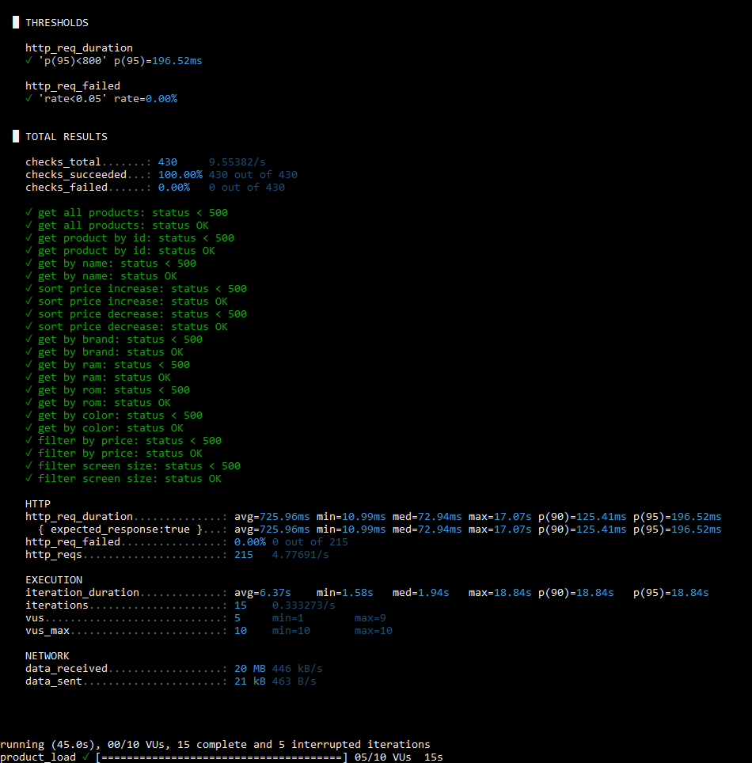

#### 20 VU

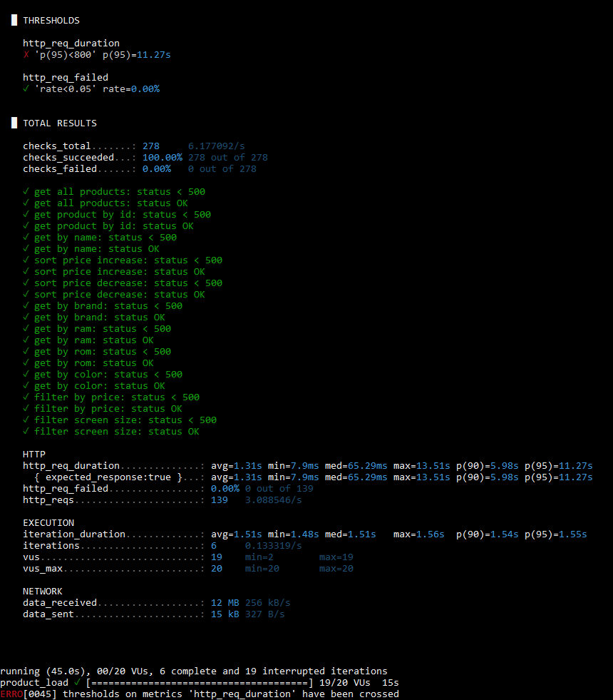

#### 50 VU

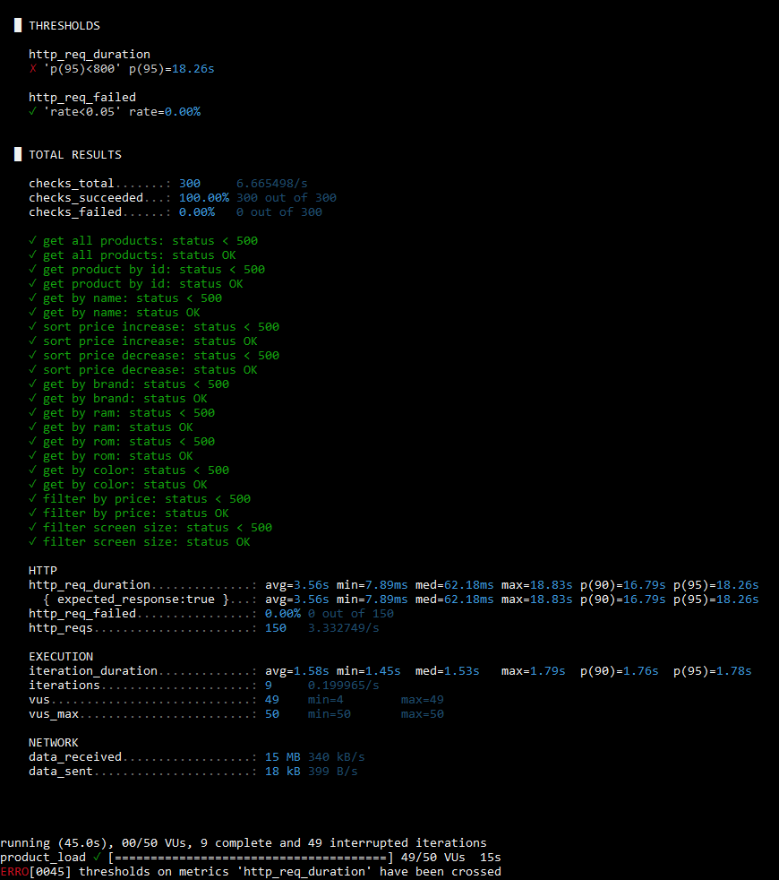
